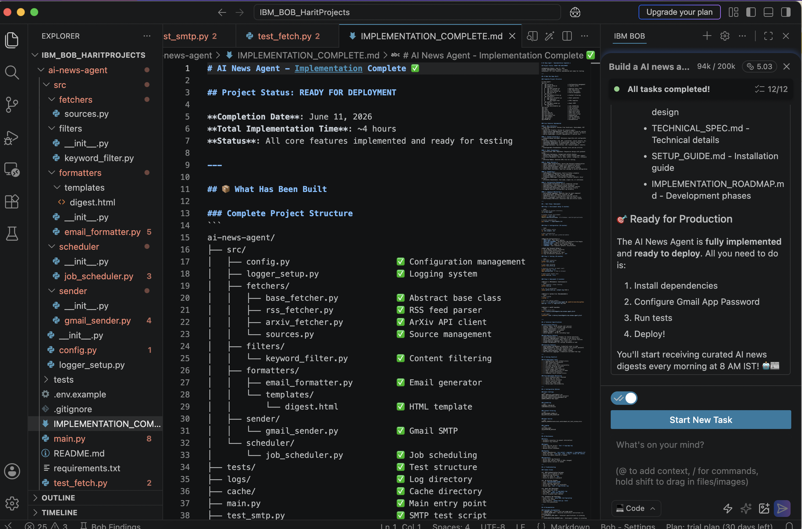

# AI News Agent using IBM BOB

A scheduled Python workflow that aggregates AI news and research, filters it by topic, and delivers a daily Gmail digest. I used IBM BOB to plan the system, review the architecture, and implement the modules. [Implementation plan](Documentation/PLAN.md) · [Run locally](Code/README.md) · [Source code](Code/src/) · [Build notes](Documentation/LEARNINGS.md)

## Product use case

A product manager following AI developments needs a manageable daily reading list. The agent pulls from a configured set of sources, prioritizes stories about LLMs and AI research, and delivers the result at 8 AM IST by default. The first version targets one recipient and a local macOS deployment.

## Workflow

**Schedule → fetch → score and group → render → preview or send**

| Stage | Behavior |
|---|---|
| Fetch | Fetch the previous 24 hours of articles from configured RSS feeds and arXiv. |
| Curate | Score stories against configurable keywords, apply the relevance cutoff, and group the results for the digest. |
| Preview or send | Generate an HTML preview or send an HTML and plain-text digest via Gmail SMTP. Log empty runs and skip the digest when no stories qualify. |
| Operate | Run the built-in APScheduler process or use macOS launchd to invoke the one-shot job. Inspect logs by stage and retry transient SMTP errors. |

The architecture separates source retrieval, filtering, formatting, scheduling, and delivery so each stage can be inspected independently. [Architecture and implementation plan](Documentation/PLAN.md)

## Run locally

1. Follow the Python and Gmail setup guide from the `Code` directory.
2. Run `python test_fetch.py` to inspect source results.
3. Run `python main.py --test` to generate `preview.html`. Use a test mailbox for validation. The preview path renders the digest locally, and exceptions can trigger an email alert.
4. When ready, select one scheduler and verify the digest arrives at the configured time. [Code quick start](Code/README.md) · [Deployment guide](Code/DEPLOYMENT_GUIDE.md)

## Success metrics

| Metric | How to measure it |
|---|---|
| On-time delivery rate | Digests verified in the recipient inbox by the agreed cutoff ÷ scheduled runs expected to send. Report genuine no-content runs and source failures separately. The original delivery target is above 99%. |
| Relevance precision | Stories the reviewer would keep ÷ stories included in the digest. Use a labeled sample with both target topics and borderline stories. |
| Source error rate | Failed source fetches ÷ attempted fetches, broken down by source. Use job logs to distinguish a feed outage from an empty feed. |

[Original targets](Documentation/PLAN.md#success-metrics)

## Product trade-offs

| Decision | Why it fits | What to watch |
|---|---|---|
| Keyword scoring | Rules are easy to tune and explain, with predictable per-run cost. | New terminology and context-dependent relevance can escape the filter. Test a labeled sample before adding model-based ranking. |
| Local scheduling | A single machine is enough for a one-recipient workflow. | Uptime depends on the host and network. Use delivery receipts to decide whether managed scheduling and monitoring are warranted. |
| Gmail SMTP and retries | Email fits the existing reading habit, and retries help with transient send failures. | Inbox delivery needs a receipt check. If retries follow an ambiguous send, track duplicate digests as a guardrail. |

## Evaluation evidence

The source includes a fetch diagnostic, an interactive SMTP check, and an HTML preview. I previously reported six months of personal use with zero missed deliveries. A run-by-run delivery audit and a labeled relevance benchmark are pending. [Fetch diagnostic](Code/test_fetch.py) · [SMTP check](Code/test_smtp.py) · [Implementation and verification notes](Code/IMPLEMENTATION_COMPLETE.md)
