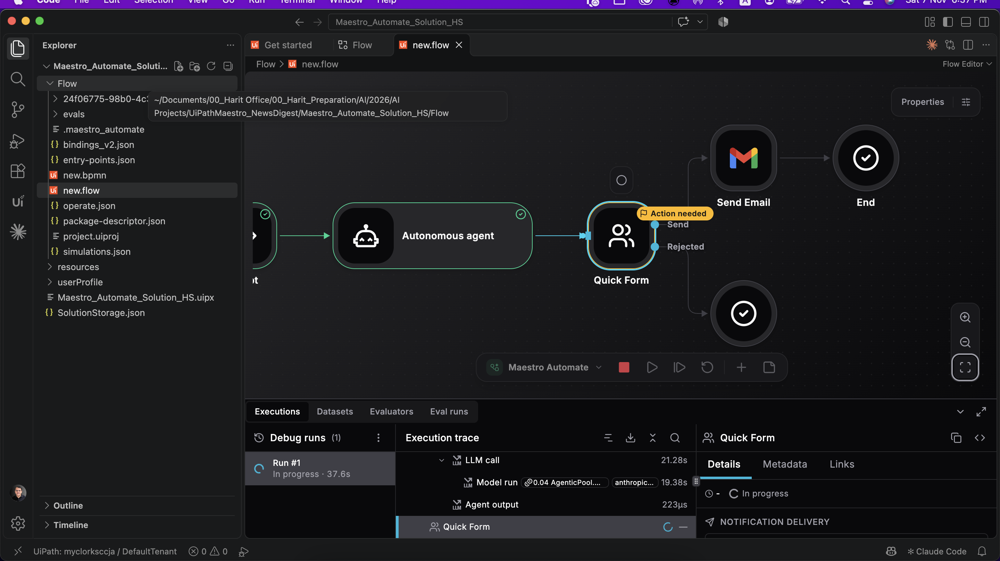
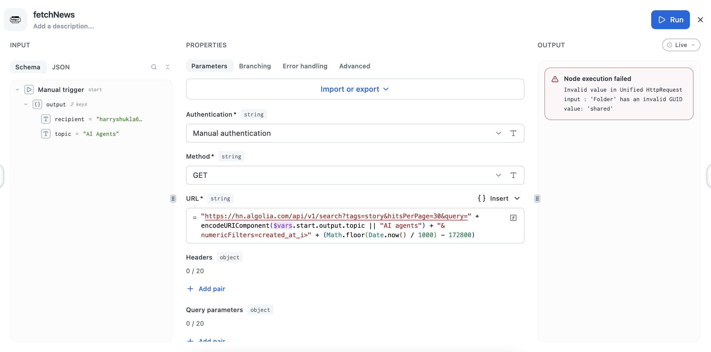
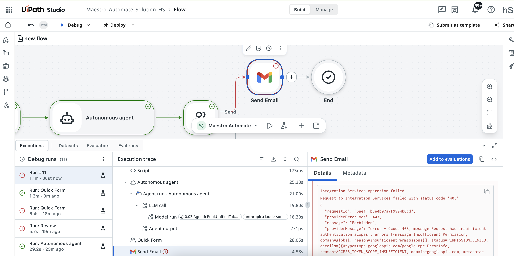
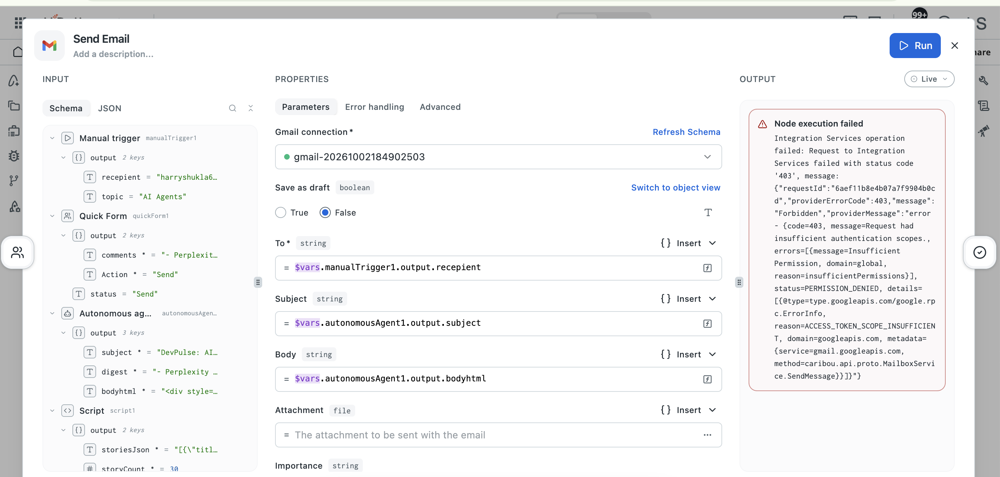

# DevPulse — AI Developer Newsletter Automation

An end-to-end newsletter automation built with UiPath Maestro Automate and Visual Studio Code. The workflow retrieves developer news, uses an autonomous agent to draft a newsletter, and requests human approval before sending it through Gmail.

This is my hands-on implementation of the [DevPulse GeeksforGeeks demo](https://github.com/dushyant-uipath/geeksforgeeks-automate-demo). I followed the original workflow and used Gmail for email delivery.

## What It Does

Given a topic and recipient, the automation:

1. Retrieves recent Hacker News stories through the Algolia Search API.
2. Prepares the retrieved data using a script.
3. Uses an autonomous agent to select relevant stories and draft a newsletter.
4. Presents the draft for human review.
5. Sends the newsletter through Gmail when approved, or ends the workflow when discarded.

## Workflow

| Step | Component | Purpose |
|---|---|---|
| 1 | Manual trigger | Accepts a topic and recipient email address |
| 2 | HTTP request | Retrieves Hacker News stories from the last 48 hours |
| 3 | Script | Structures the API response for the agent |
| 4 | Autonomous agent | Selects five useful stories and generates the newsletter |
| 5 | Human review | Presents the draft with Send and Discard options |
| 6 | Decision | Routes execution based on the review outcome |
| 7 | Gmail connector | Sends the approved newsletter |
| 8 | End | Completes the workflow |

### End-to-End Flow Canvas

The complete workflow in UiPath Maestro Automate’s new Flow canvas, showing how data retrieval, agent execution, human review, and email delivery connect.


## Human-in-the-Loop Review

The human review step provides a checkpoint before the newsletter is sent. A reviewer can inspect the generated content and choose **Send** or **Discard**.

A useful feature demonstrated here is the ability to review the human task inline within the Maestro Automate experience.



## Final Email

After approval, the Gmail connector delivers the newsletter to the recipient.


## Tools and Services

- **UiPath Maestro Automate:** Workflow orchestration using the Flow canvas
- **Visual Studio Code:** Local development environment
- **Hacker News Algolia API:** News retrieval
- **Autonomous agent:** Story selection and newsletter generation
- **Human review task:** Approval before delivery
- **UiPath Integration Service:** Gmail connection
- **Gmail:** Newsletter delivery

## Issues Encountered and Resolutions

### 1. GUID-Related Error

I encountered a GUID-related error while using a local UiPath workspace.

**What I tried:** Saved the workspace to the cloud and attempted to run the workflow again. The error persisted.

**What resolved it:** Created a new solution project and rebuilt the entire workflow. Execution then proceeded past the error.

This was the workaround that succeeded in my environment; I did not establish the underlying root cause.



### 2. Gmail Connector Errors

I also encountered Gmail connector errors involving the connection in UiPath Integration Service.

**Resolution:** Re-established the Gmail connection in Integration Service, then reran the workflow.

This highlighted the importance of checking connector authentication and connection configuration when troubleshooting delivery failures.





## Running the Project

### Prerequisites

- Access to UiPath Maestro Automate
- VS Code with the required UiPath tooling
- Access to the model used by the autonomous agent
- A configured human review task
- An active Gmail connection in UiPath Integration Service

### Execution

1. Open the solution using the UiPath tooling.
2. Configure the agent, review task, and Gmail connection for your environment.
3. Start the workflow using the manual trigger.
4. Provide a recipient and topic, for example:

   ```json
   {
     "recipient": "you@example.com",
     "topic": "AI agents"
   }
   ```

5. Inspect the generated newsletter in the human review step.
6. Select **Send** to deliver it or **Discard** to end the run.
7. Inspect the execution trace and verify delivery when Send is selected.

For the original demo’s detailed setup instructions, see the [source repository](https://github.com/dushyant-uipath/geeksforgeeks-automate-demo). Its folder paths and Outlook-specific configuration differ from this implementation.

Credentials and account connections must be configured separately.

## What I Learned

- Building an agentic workflow with Maestro Automate’s Flow canvas.
- Combining API requests, scripts, and an autonomous agent.
- Adding human oversight before email delivery.
- Reviewing a human task inline during execution.
- Configuring and troubleshooting an Integration Service connection.
- Using execution traces to investigate workflow failures.
- Documenting workarounds alongside successful results.

## Project Context and Attribution

This is a tutorial-based learning and portfolio project.

The original DevPulse workflow and demo were created by [dushyant-uipath](https://github.com/dushyant-uipath) for a GeeksforGeeks webinar:

[Original DevPulse repository](https://github.com/dushyant-uipath/geeksforgeeks-automate-demo)

My work involved implementing the complete workflow in my own environment, configuring Gmail delivery, running the automation, and troubleshooting the issues documented above.

## Author

[Harit Shukla](https://github.com/haritshukla77)
