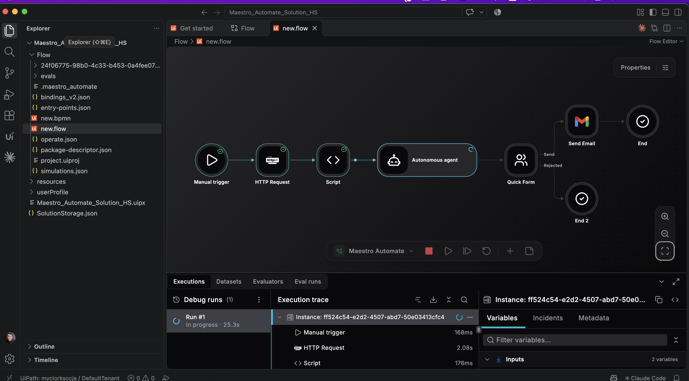
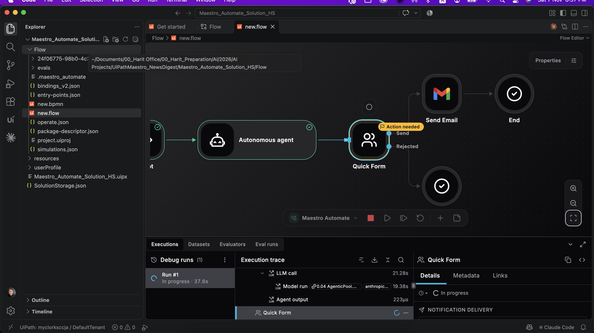

# Agentic Workflow Automation using UiPath Maestro

An approval-gated developer newsletter workflow built in UiPath Maestro Automate. I implemented the DevPulse tutorial in my environment, configured Gmail delivery, and documented the failures I encountered during setup. [Workflow export](Flow/new.bpmn) · [Agent configuration](Flow/24f06775-98b0-4c33-b453-0a4fee0750bf/agent.json) · [Original DevPulse tutorial](https://github.com/dushyant-uipath/geeksforgeeks-automate-demo)

## Product use case

A newsletter editor wants to turn recent developer news into an issue worth sending. The workflow drafts from a topic and recent Hacker News stories. The editor reviews the draft and decides whether it should go to the intended recipient.

## Workflow

**Topic and recipient → retrieve stories → prepare data → draft → review → send or discard**

| Stage | Behavior |
|---|---|
| Retrieve | A manual trigger takes the topic and recipient. The Algolia Search API retrieves matching Hacker News stories from the previous 48 hours. |
| Prepare and draft | A script structures the story metadata. The agent is prompted to select five useful stories and produce a subject, plain-text digest, and HTML newsletter. |
| Review | Maestro presents the draft in an inline human task with **Send** and **Discard** options. |
| Deliver | The decision routes **Send** to the Gmail connector and **Discard** to the end of the workflow. |






## Run in UiPath Maestro

1. Open the solution with Maestro Automate tooling in VS Code. Set up model access, assign the human review task, and bind a Gmail connection in UiPath Integration Service for your environment.
2. Start the manual trigger with a topic and an inbox you control. The exported field name is `recepient`.

   ```json
   {
     "recepient": "you@example.com",
     "topic": "AI agents"
   }
   ```

3. Review the draft inline and choose **Send** or **Discard**.
4. Inspect the execution trace. For **Send**, confirm delivery in the intended inbox. For **Discard**, verify the Gmail step was skipped. [Entry-point schema](Flow/entry-points.json) · [Original demo setup](https://github.com/dushyant-uipath/geeksforgeeks-automate-demo)

## Success metrics

| Metric | How to measure it |
|---|---|
| Editorial acceptance rate | Drafts approved without material correction ÷ drafts reviewed. Score story relevance and factual support from the retrieved metadata. |
| End-to-end task completion rate | Runs that reach their expected outcome ÷ runs started. Verify inbox delivery for **Send** and zero sends for **Discard**. |
| Time to approved issue | Elapsed time from trigger to approval. Track active editorial time separately and compare with compiling the same digest manually. |

Treat an email sent without approval or to the wrong recipient as a critical failure. A repeatable benchmark is pending.

## Product trade-offs

| Decision | Why it fits | What to watch |
|---|---|---|
| Script the retrieval and data preparation | Keeps the source, time window, and story fields explicit. | Missing or sparse search results need a defined editorial response. |
| Delegate story selection and drafting to the agent | Lets the workflow adapt the issue to a new topic with the same structure. | Check every selected link and claim against the retrieved stories. Model output can introduce unsupported details. |
| Require approval before Gmail | Gives the editor control over a recipient-facing action. | Review adds a pause to each run. Measure active editing time and waiting time separately. |
| Use a managed Gmail connection | The flow uses Integration Service to bind the sender in its environment. | A missing or stale binding can block delivery after approval. Capturing the trace helps locate the failure. |

## Evaluation evidence

The canvas, review screenshot, and delivered email document the approved path in my environment. The exported evaluation set has evaluator definitions and zero saved evaluation cases. For a repeatable check, use fixed story inputs, verify the selected links and claims, and exercise **Send**, **Discard**, sparse results, and connector failure. [Evaluation set](Flow/evals/c5dfae9b-d1e0-4283-8dac-191df1b12217/eval-sets/evaluation-set.json)

### Failure handling

| Failure observed | What worked |
|---|---|
| GUID error in the local workspace | Moving the existing workspace to the cloud reproduced the error. Rebuilding the flow in a new solution let execution proceed. The root cause remains open. [Error screenshot](Screenshots/Error_1_GUID.png) |
| Gmail connection errors | Re-established the Gmail connection in Integration Service, then reran the workflow. [First error view](Screenshots/Error_2_Integration_1.png) · [Second error view](Screenshots/Error2_Integration_2.png) |

## Credits

DevPulse was created by Dushyant for a GeeksforGeeks webinar. This case study documents my implementation, Gmail configuration, and troubleshooting. [Original project](https://github.com/dushyant-uipath/geeksforgeeks-automate-demo)
