# Transcript to Linear

Turn a product meeting transcript into a reviewed product requirements document (PRD) and publish the agreed work to Linear. When new feedback changes a requirement, preview an update to its linked issue.

I adapted Mistral’s published workflow to explore how AI can help PMs turn meeting decisions into engineering work. [Original Mistral workflow](https://mistral.ai/news/agentic-workflows-from-meetings-to-dev-tickets/)

[Open in Colab](https://colab.research.google.com/github/haritshukla77/ai-product-lab/blob/main/Transcript-to-Linear/TranscriptToLinear_RevisionWorkflow.ipynb) · [Notebook](TranscriptToLinear_RevisionWorkflow.ipynb) · [Runbook and workflow diagram](RUNBOOK.md) · [Changes from Mistral](CHANGES.md) · [Success metrics](#success-metrics) · [Evaluation](evals/README.md)

## Product use case

After a planning meeting, a PM and engineer need to agree on which work is ready to enter the backlog. A transcript may mix existing problems, brainstorms, and decisions. The workflow gives the reviewers a first draft, highlights gaps, and carries their decisions through to the corresponding Linear issue.

## Workflow

**First publish** · Extract the transcript → draft and review the PRD → preview tickets → publish to Linear.

### 1. Generate and review

Mistral OCR extracts the text from the PDF. The PRD agent drafts the document and runs up to three automated review rounds. The PM checks that agreed work is actionable, proposals stay exploratory, and unresolved targets stay open. Enter `REVISE` to give feedback, `APPROVE` to draft tickets, or `STOP` to end the run.

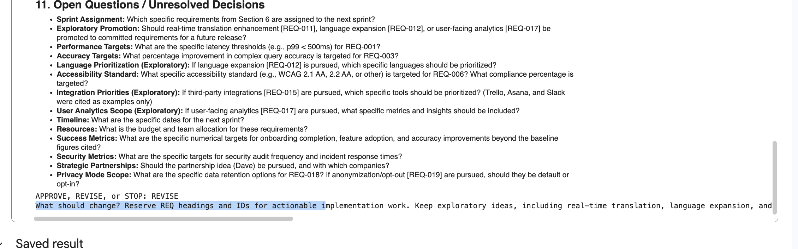

*The reviewer uses `REVISE` to ask that requirement IDs be reserved for actionable work and that exploratory ideas stay in the PRD as proposals.*

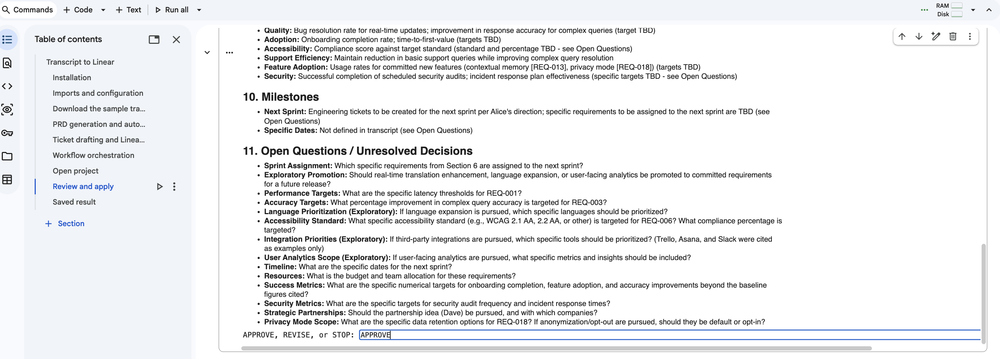

*The revised PRD keeps the latency threshold open. The reviewer enters `APPROVE` to draft tickets from it.*

### 2. Preview and publish

The ticket agent drafts one issue per actionable requirement in the approved PRD. Review the proposed scope and acceptance criteria. Enter `APPLY` to publish the preview and save each requirement’s link to its Linear issue.

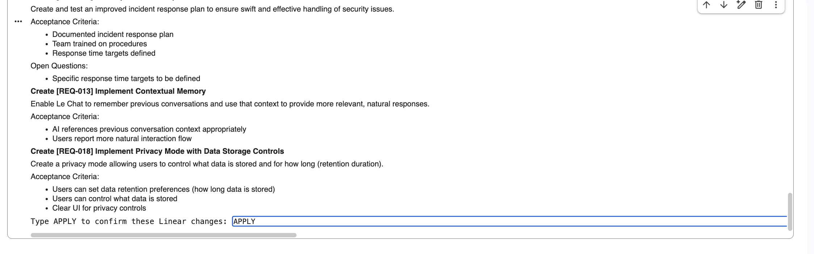

*The ticket preview shows the proposed descriptions and acceptance criteria before publishing.*

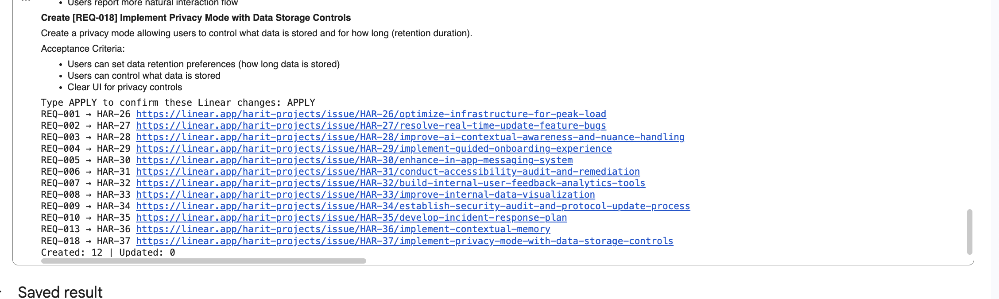

*After `APPLY`, Colab reported **12 created, 0 updated** and printed the new mappings, including REQ-001 → HAR-26.*

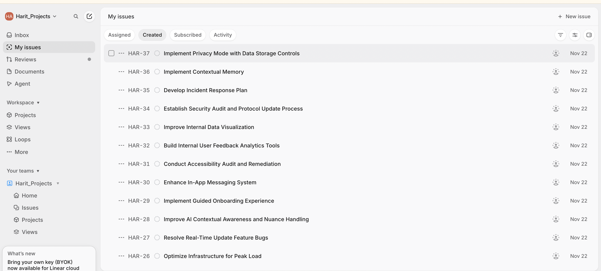

*The published batch in Linear runs from HAR-26 through HAR-37.*

### 3. Revise an existing issue

Reopen the saved project and select a linked requirement. Enter feedback, approve the revised PRD, then review the description diff for the original issue. Enter `APPLY` to update that issue. The saved requirement ID and Linear issue ID determine which ticket receives the change.

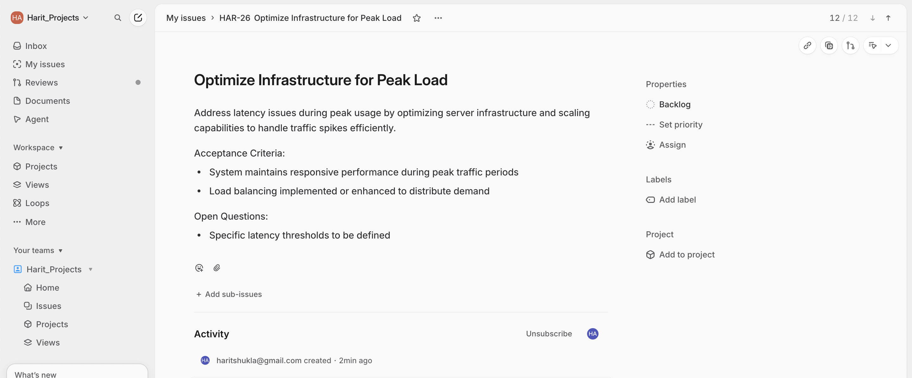

*Before feedback, HAR-26 leaves the latency threshold open. The revision below adds a p95 baseline measurement.*

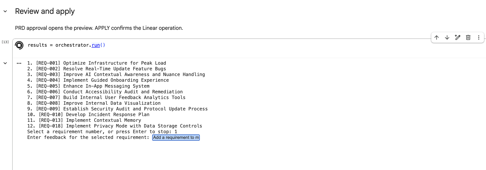

*The reviewer selects REQ-001, the peak-load performance requirement, and enters feedback.*

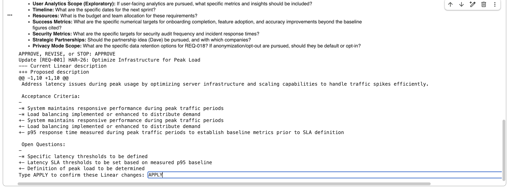

*The preview resolves REQ-001 to HAR-26. The proposed description adds a p95 baseline measurement and keeps the SLA threshold and peak-load definition open.*

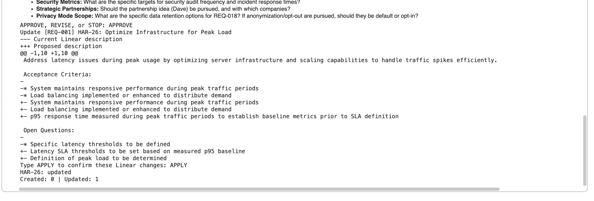

*Colab confirms the update to HAR-26 and reports **0 created, 1 updated**.*

## Run in Colab

The [runbook](RUNBOOK.md) includes the full workflow, the feedback demo, and the fallback for Google Drive authorization errors.

1. Add `MISTRAL_API_KEY`, `LINEAR_API_KEY`, and `LINEAR_TEAM_ID` as Colab secrets and enable notebook access. Use a Linear test team and a key with permission to read, create, and update its issues.
2. Run setup through **Open project**. The notebook mounts Google Drive and uses Mistral’s sample transcript for a new project. The project file in Drive holds the transcript, approved PRD, issue links, and any pending apply plan.
3. Run **Review and apply**. Use `APPROVE` to reach the ticket preview and `APPLY` to confirm the Linear operation.
4. To revise a linked issue, reopen the same project with its saved state and Linear team, then run **Review and apply** again. Use one Colab runtime per project.

## Success metrics

The primary metric is **PM and engineering minutes per accepted issue**. An accepted issue reflects agreed scope, has testable acceptance criteria, and records open decisions. Compare manual and assisted work on the same cases, with first publishes and revisions reported separately.

| Metric | How to measure it |
|---|---|
| **Active minutes per accepted issue** | Total active PM and engineering minutes, including corrections and recovery, ÷ accepted issues. |
| **Task completion rate** | Tasks with a verified outcome ÷ tasks started. A publish must create the expected linked issues. A revision must apply the approved change to the original issue without extra writes. Count an expected no-op as complete and report deliberate stops separately. |
| **Workflow error rate** | Tasks that encounter at least one system error ÷ tasks started. Report the stage and cause, along with whether the task recovered. |
| **Requirement recall** | Correctly represented actionable requirements ÷ actionable requirements independently labeled by reviewers. Score at the PRD and final-ticket stages to locate omissions. |
| **Unsupported commitment rate** | Drafts or issues with an unapproved scope item, target, or deadline ÷ artifacts reviewed at that stage. Score the PRD, ticket preview, and final issues separately. |
| **Linear write success rate** | Confirmed plans with the expected Linear changes verified by the deadline ÷ confirmed plans with writes. Count each plan once across retries. |
| **End-to-end elapsed time** | Time from transcript submission or revision feedback to a verified outcome. Record time to the first complete preview and reviewer wait separately. |

**Proposed pilot bar.** Aim for at least **20% lower active time per accepted issue** than manual drafting. Task completion and requirement recall should hold or improve, with zero unsupported commitments in accepted issues. The write-safety checks must show zero duplicate creates, wrong-issue updates, and writes without `APPLY`. Establish error-rate and latency baselines before setting their targets. [Measurement protocol](evals/README.md#measurement-protocol)

**Evidence to date.** One live rehearsal created 12 linked issues, updated HAR-26 in place, and made zero writes when the completed apply was replayed in the same session. The manual baseline and broader benchmark are pending. [Live evidence](evals/README.md#live-colab-rehearsal)

## Product trade-offs

**Product decision.** Start with an approval-gated backlog workflow for one team. A faster initial draft can still cost the team time if it creates scope disputes or rework.

### Model selection, latency, and quality

Mistral Large was used for ticket drafting in the upstream notebook. This project uses it for both text stages, and the revised configuration completed the 12-issue rehearsal. That makes it the baseline for comparison. [Model configuration](CHANGES.md)

| Stage | Current setup | Why it fits the stage |
|---|---|---|
| Transcript extraction | Mistral OCR | Converts the PDF into source text for the PRD. |
| PRD generation, review, and revision | `mistral-large-latest` with the model’s default reasoning effort | The PRD stage has to distinguish agreed work, exploratory ideas, and open decisions across the transcript. Errors here can carry into every downstream ticket. |
| Ticket drafting | `mistral-large-latest` with `reasoning_effort="low"` and an 8,192-token output cap | The approved PRD already defines the scope. The model produces a short summary and up to three testable criteria per issue. Code validates one nonempty draft per actionable requirement ID. |

**Output truncation.** Early ticket drafts hit the output limit twice, including after the cap rose from 2,048 to 8,192 tokens. We kept the higher cap, lowered reasoning effort, and shortened the requested ticket format. The approved PRD still determines the number of tickets.

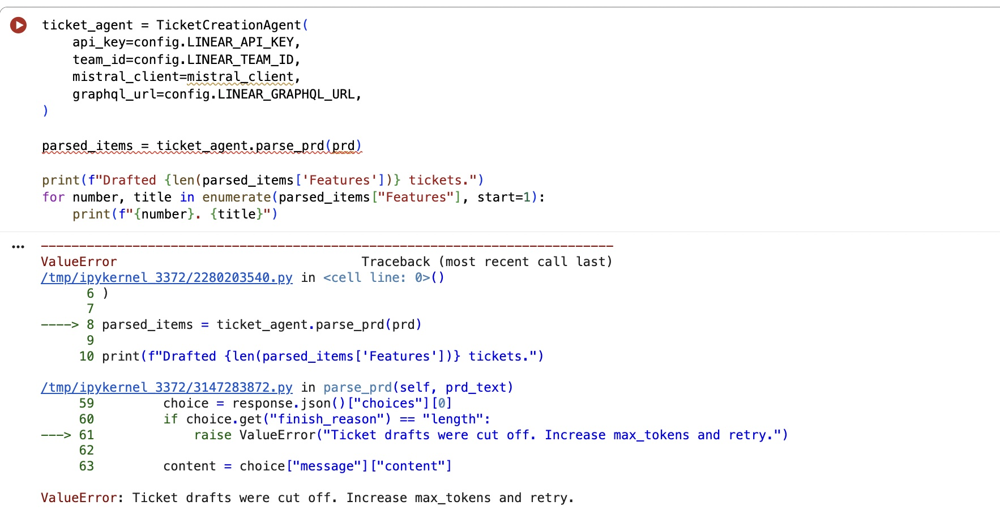

**Read timeout.** A separate attempt hit the 120-second read timeout. We raised it to 600 seconds for testing. A longer timeout also extends how long a stalled call can block the workflow. The 12-issue run used the combined configuration, so the effect of each change remains unmeasured.

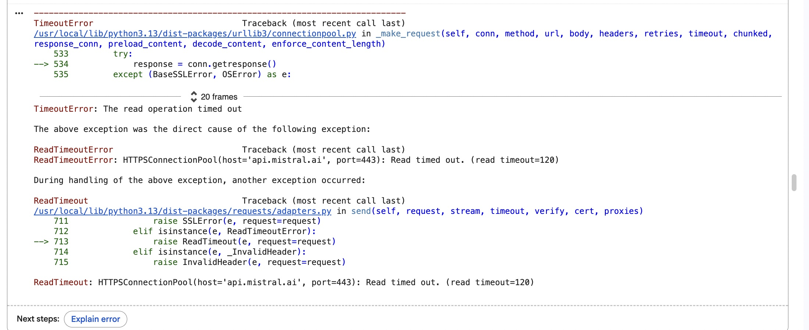

**Next model decision.** Benchmark a pinned Mistral Small version on the same approved PRDs. Keep it only if it preserves coverage, grounded criteria, and preview completion while improving latency or cost per accepted issue. Test reasoning effort separately on a single pinned model. For PRD review, use higher effort if it reduces omissions, unsupported commitments, or human rework enough to justify the added latency. [Model comparison protocol](evals/README.md#model-comparison)

### Human review and requirement identity

- **Two approval checkpoints.** The PRD review settles what the team agreed to build. The ticket preview catches scope changes or unsupported targets introduced during drafting. A second confirmation costs reviewer time and lets reviewers approve the exact Linear changes.
- **Stable issue identity.** Each requirement ID maps to a saved Linear UUID, so title or wording changes do not affect matching. One issue per requirement keeps the mapping simple. Splits, merges, and scope removals need explicit review because they can change ownership and dependencies.

### Failure handling and production controls

| Failure | Notebook behavior | Control for a shared production deployment |
|---|---|---|
| Model timeout, truncated JSON, or invalid requirement IDs | Drafting stops before the publish preview. Linear receives zero writes and the last applied project remains available. | Record failure reason, elapsed time, and token use by stage. Retry transient failures within a time budget. For recurring truncation, draft in bounded batches and validate all requirement IDs before showing a publish preview. |
| Linear write times out or a batch stops partway through | The confirmed plan and preassigned issue UUIDs are saved before writes. Each completed action is checkpointed. Resume skips completed actions and checks the same UUID when a create result is ambiguous. | Use a durable job store, serialize writes per project, and reconcile uncertain API results by UUID before retrying. Surface permanent permission and validation failures to the operator. |
| An issue changes after preview | The notebook re-reads the description before writing. If it already matches the proposed text, the operation is a no-op. An intervening edit blocks the update and calls for a fresh diff. | The read and write are separate calls. Use an atomic version check if the API supports one. Otherwise limit who can write the managed description and surface conflicts for human review. |
| Colab storage is lost or Drive authorization fails | The notebook can store a project JSON in the current runtime and restore it from a downloaded copy. The live rehearsal used this fallback. | Persist state outside the execution environment and test backup restore. Keep transcript access, retention, and issue-write credentials scoped to the team. |

### Rollout bar and evidence

Start in preview mode, then enable approval-gated writes for one team. Use the [pilot bar](#success-metrics) to decide when to expand. [Recovery runbook](RUNBOOK.md#recover-from-an-interrupted-apply)

## Credits

Adapted from Mistral AI’s [Transcript-to-PRD-to-Ticket notebook](https://github.com/mistralai/cookbook/blob/main/mistral/agents/non_framework/transcript_linearticket_agent/TranscriptToLinearTicketAgent.ipynb) and [workflow article](https://mistral.ai/news/agentic-workflows-from-meetings-to-dev-tickets/). The upstream [MIT license](LICENSE) is included.
