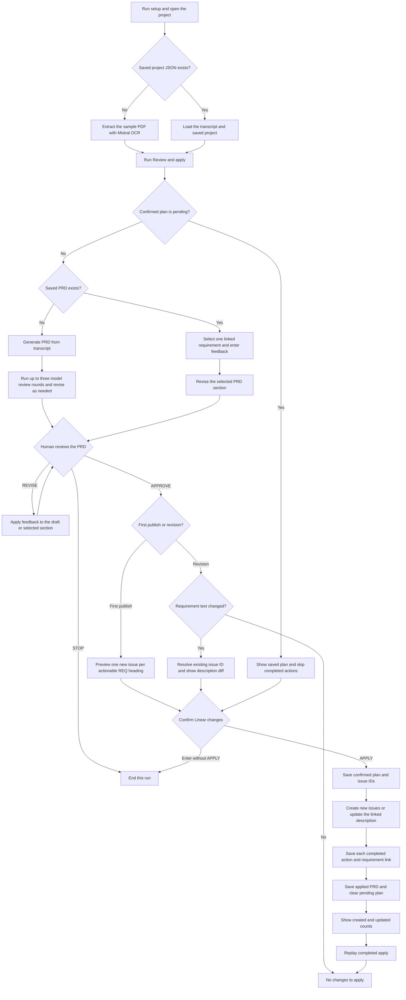

# Transcript to Linear runbook

Use this guide to publish a reviewed PRD as Linear issues, apply feedback to one linked issue, and check that replaying a completed apply makes zero writes. The default input is Mistral’s Le Chat planning transcript.

[Open in Colab](https://colab.research.google.com/github/haritshukla77/ai-product-lab/blob/main/Transcript-to-Linear/TranscriptToLinear_RevisionWorkflow.ipynb) · [Change log](CHANGES.md) · [Evaluation](evals/README.md)

## End-to-end workflow



A first publish can have zero actionable requirements. In that case, `APPLY` saves the approved PRD with zero Linear writes. A pending plan is saved before the first remote mutation, so an interrupted apply can be reviewed and resumed.

## 1. Set up Colab

1. Open the notebook and choose **File → Save a copy in Drive**.
2. In Colab **Secrets**, add `MISTRAL_API_KEY`, `LINEAR_API_KEY`, and `LINEAR_TEAM_ID`. Enable **Notebook access** for each. The team ID is the destination team’s UUID. Use a team you can test in and a Linear key that can read, create, and update issues there.
3. Run **Installation**, then the imports and configuration cells. Leave `PROJECT_NAME` set to `le-chat-planning` for the sample, or choose a name for a separate project.
4. Run **Download the sample transcript**, the **PRD generation and automated review** cell, the **Ticket drafting and Linear operations** cell, and the **Workflow orchestration** cell.
5. Run both **Open project** cells in order. The first defines the OCR function. The second mounts Drive and opens the project. It runs OCR if no saved project exists.

The default state file is `MyDrive/transcript-to-linear/<PROJECT_NAME>.json`. It holds the extracted transcript, approved PRD, Linear issue links, and any pending plan. Use the same project name, team, and state file for the first publish and follow-up revisions. Keep the state file private.

## 2. Publish for the first time

1. Run **Review and apply**. It generates the PRD and performs up to three automated review rounds. Each round can revise the draft based on the model’s findings.
2. At **APPROVE, REVISE, or STOP**, review the PRD. Check that actionable work has `### [REQ-…]` headings, brainstorms stay under Proposed Ideas, and unagreed targets stay open. Enter `REVISE` and your feedback to see another version, `APPROVE` to proceed, or `STOP` to end.
3. After `APPROVE`, review the ticket preview. Each proposed ticket shows its requirement ID, title, and description. Check that exploratory ideas remain out of the implementation batch and that criteria reflect the approved PRD.
4. Type `APPLY` to create the previewed issues. The output prints the requirement-to-issue links and the created/updated counts. Pressing Enter without `APPLY` leaves the preview unapplied.
5. Open one issue in Linear and capture its before description and visible issue ID for the demo.

A new project has no existing issue links. A first publish can overlap with issues from older, unlinked runs. The workflow adds links as it publishes the new batch.

## 3. Revise one linked issue

1. In the same project, run **Review and apply** again. It lists the linked requirements from the saved PRD. Select the number next to the requirement you want to revise, then enter feedback.
2. Review the selected section in the resulting full PRD. Use `REVISE` if it needs another change. Use `APPROVE` when it reflects your decision.
3. Check that the preview says **Update** and shows the expected Linear issue ID. In the diff, `-` marks removed lines and `+` marks added lines. A change in bullet formatting can appear as both a removal and an addition.
4. Type `APPLY`. A changed description should produce **Created: 0 | Updated: 1**. Refresh the existing issue in Linear to confirm its description and capture an after screenshot with the same issue ID.
5. Run **Saved result** to display the applied PRD and its requirement-to-issue UUIDs.

For the peak-load example, use feedback such as “Measure p95 response time during peak traffic before setting a latency SLA. Leave the SLA and definition of peak load open.” The measurement becomes part of the draft because the reviewer requested it. The target remains an open decision.

## 4. Verify replay

Add a new code cell below **Saved result** and run it after the update finishes:

```python
assert orchestrator.load_state()["pending"] is None, "An apply is still pending."
orchestrator.apply_changes()
```

The expected output is **No changes to apply.** and `{'created': 0, 'updated': 0}`. This replays the apply step against the completed saved plan. Running **Review and apply** again starts a fresh feedback cycle. For a restart check, reopen the same saved project from a fresh runtime and run the guarded replay again.

## If Drive authorization fails

The notebook can be saved in Drive even when the Colab runtime fails to mount Drive. For a first run in your current session, replace the first two lines of the lower **Open project** cell with the line below and keep the rest of the cell.

```python
project_path = Path("/content/transcript-to-linear") / f"{PROJECT_NAME}.json"
```

Run both publish and revision from that same path. After applying changes and before disconnecting, download the JSON from **Files → transcript-to-linear**, or run:

```python
from google.colab import files

files.download(str(project_path))
```

To continue in a fresh runtime using the local-storage workaround, run setup through the OCR definition, then upload the saved JSON into the project directory **before** running the lower **Open project** cell:

```python
from google.colab import files

project_path = Path("/content/transcript-to-linear") / f"{PROJECT_NAME}.json"
if project_path.exists():
    raise FileExistsError(f"Project already exists: {project_path}")

uploaded = files.upload()
if len(uploaded) != 1 or project_path.name not in uploaded:
    raise ValueError(f"Choose the saved file named {project_path.name}.")
data = json.loads(uploaded[project_path.name])
if data["team_id"] != config.LINEAR_TEAM_ID:
    raise ValueError("This project belongs to a different Linear team.")

project_path.parent.mkdir(parents=True, exist_ok=True)
project_path.write_bytes(uploaded[project_path.name])
```

Then run **Open project** with the same local path. Confirm that **Review and apply** shows the linked requirements, or offers to resume a pending plan if the previous apply was interrupted. [Colab Drive authorization issue report](https://github.com/googlecolab/colabtools/issues/5944)

## Recover from an interrupted apply

- **An apply failed partway through.** Preserve the project JSON. Rerun **Review and apply** with the same state file, review the saved plan, and confirm again. Completed actions are skipped. For a pending create, the original issue UUID is reused.
- **Linear changed after preview.** Rerun **Review and apply** to see the new description diff. Review the current text before confirming a replacement.
- **The notebook starts generating a fresh PRD when you expected revisions.** Stop at the PRD prompt and check the project name and JSON path. Restore the previous state before applying.
- **The linked issue can’t be read or updated.** Check that the issue exists in the configured team and that the key has the corresponding permission.

## What to capture for a demo

Show the first publish once, then follow one issue through a later revision. The clearest sequence is the approved PRD, the first publish count, the issue before feedback, the targeted diff, the same issue after applying, and the zero-write replay. For a live interview, open the existing saved project and demonstrate a new revision. Keep the notebook with cleared outputs in GitHub and share selected screenshots with account details cropped out.

See the [live rehearsal results](evals/README.md#live-colab-rehearsal) for the observed first publish and replay counts.
